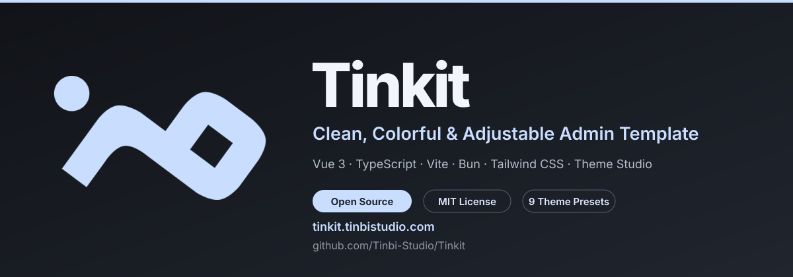
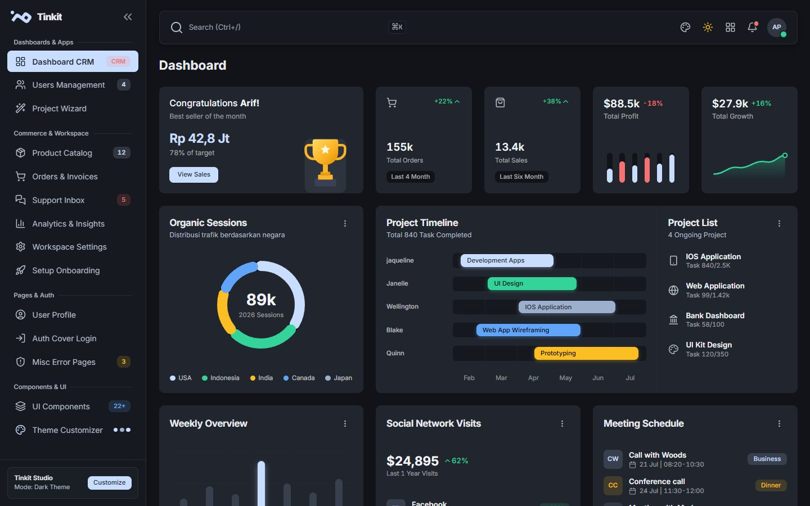

<div align="center">
  <a href="https://github.com/Tinbi-Studio/Tinkit">
    
  </a>

  <p>
    <a href="https://github.com/Tinbi-Studio/Tinkit/stargazers">
      
    </a>
    <a href="https://github.com/Tinbi-Studio/Tinkit/network/members">
      
    </a>
    <a href="https://github.com/Tinbi-Studio/Tinkit/issues">
      
    </a>
    <a href="https://github.com/Tinbi-Studio/Tinkit/commits">
      
    </a>
    
  </p>

  <p>
    <a href="https://vuejs.org">
      
    </a>
    <a href="https://www.typescriptlang.org">
      
    </a>
    <a href="https://vitejs.dev">
      
    </a>
    <a href="https://bun.sh">
      
    </a>
    <a href="https://tailwindcss.com">
      
    </a>
  </p>

  <p>
    <a href="https://tinkit.tinbistudio.com">
      
    </a>
    <a href="https://github.com/Tinbi-Studio/Tinkit">
      
    </a>
  </p>

  <p>
    <strong>⚡ Cepat dibuat. 🎨 Mudah disesuaikan. 🧩 Siap dikembangkan.</strong><br />
    Template administrator open-source berbasis Vue 3 + TypeScript untuk dashboard, SaaS back-office, dan aplikasi internal.
  </p>

  <p>
    <a href="https://tinkit.tinbistudio.com">🌐 Website</a> •
    <a href="https://github.com/Tinbi-Studio/Tinkit">🐙 GitHub</a> •
    <a href="#-fitur-unggulan">Fitur</a> •
    <a href="#-preview">Preview</a> •
    <a href="#-theme-studio">Theme Studio</a> •
    <a href="#-quick-start">Quick Start</a> •
    <a href="#-kontribusi">Kontribusi</a>
  </p>
</div>

---

## 🔗 Repository & Links

| Link | Tujuan |
| :--- | :--- |
| **🌐 Website** | [tinkit.tinbistudio.com](https://tinkit.tinbistudio.com) |
| **🐙 GitHub** | [Tinbi-Studio/Tinkit](https://github.com/Tinbi-Studio/Tinkit) |
| **⭐ Star the repository** | [Tinbi-Studio/Tinkit/stargazers](https://github.com/Tinbi-Studio/Tinkit/stargazers) |
| **🐛 Issues** | [Laporkan bug atau fitur](https://github.com/Tinbi-Studio/Tinkit/issues) |
| **🔀 Fork** | [Buat versi kamu sendiri](https://github.com/Tinbi-Studio/Tinkit/fork) |

---

## 🌟 Why Tinkit?

**Tinkit** adalah template administrator *open-source* modern berbasis **Vue 3 + Vite + Bun + TypeScript** yang mengusung filosofi **Clean, Colorful & Adjustable**.

Tidak seperti template admin yang kaku atau penuh dependensi berat, Tinkit dibangun di atas:

- **Custom Semantic Tailwind CSS** — class seperti `.btn`, `.card`, `.badge`, `.input`, `.alert`, dan `.table`.
- **CSS Variables sebagai design tokens** — warna, radius, surface, dan tipografi dapat diganti secara langsung.
- **Typed Vue components** — `<UiButton>`, `<UiCard>`, `<UiModal>`, `<UiSelect>`, dan puluhan komponen lain.
- **Live Theme Studio** — ganti preset, mode terang/gelap, warna brand, radius, font global, lalu ekspor CSS-nya.
- **Zero heavy UI framework** — seluruh styling dapat dibaca, dimodifikasi, dan di-maintain sendiri.

---

## ✨ Fitur Unggulan

| Area | Yang kamu dapatkan |
| :--- | :--- |
| **Developer experience** | Vue 3.5, Composition API, Strict TypeScript, Vue Router, Pinia, Vite 8, dan Bun. |
| **Design system** | Semantic classes, RGB color channels, opacity modifiers, dan komponen bertipe kuat. |
| **Theme engine** | 9 preset, light/dark mode, custom brand color, radius scale, dan content width. |
| **Typography** | Pilihan global Inter, Plus Jakarta Sans, atau System UI; code tetap monospace. |
| **Interaction states** | Active/selected control menggunakan solid fill, focus ring keyboard tetap terpisah. |
| **Component catalog** | Button, card, modal, tabs, table, form, alert, badge, stepper, timeline, upload, editor, dan banyak lagi. |
| **Persistence** | Preferensi Theme Studio disimpan di `localStorage` dan dipulihkan saat reload. |
| **Export** | Salin CSS variables hasil kustomisasi langsung dari Theme Studio. |

---

## 🖼️ Preview

<div align="center">
  
</div>

Halaman `/components` berfungsi sebagai dokumentasi hidup untuk seluruh class semantik dan komponen Vue.

---

## 🎨 Theme Studio

Theme Studio dapat dibuka dari sidebar, navbar, atau footer.

| Preset | Karakter |
| :--- | :--- |
| `tinkit` | Neutral ink dan pale blue yang tenang. |
| `daybreak` | Indigo royal dengan slate netral. |
| `midnight` | Navy dalam dengan biru elektrik. |
| `aurora` | Charcoal botani dengan mint emerald. |
| `nebula` | Plum obsidian dengan violet lembut. |
| `sunset` | Warm espresso dengan amber dan tangerine. |
| `ocean` | Oceanic slate dengan cerulean dan aqua. |
| `matcha` | Forest charcoal dengan sage dan leaf green. |
| `berry` | Plum nocturnal dengan orchid dan lavender. |

Kamu juga dapat mengatur:

- **Primary, Secondary, dan Accent color** melalui color picker.
- **Light/Dark mode**.
- **Radius scale** dari sharp sampai pill.
- **Compact, Wide, atau Full-width layout**.
- **Global font family**.
- **Export CSS variables** untuk dipakai di proyek lain.

---

## 🔤 Global Font Customization

Tinkit menyediakan font picker terkurasi yang tersimpan secara persisten:

| Pilihan | Perilaku |
| :--- | :--- |
| **Inter** | Default modern dan sangat terbaca untuk dashboard. |
| **Plus Jakarta Sans** | Karakter lebih hangat dan geometris. |
| **System UI** | Memakai font bawaan perangkat tanpa font download tambahan. |

Pilihan ini diterapkan ke seluruh aplikasi melalui `--font-sans`, sementara `--font-mono` tetap digunakan untuk code block, identifier, source editor, dan konten teknis.

---

## 🚀 Quick Start

Pastikan [Bun](https://bun.sh/) sudah terinstal.

```bash
# 1. Clone repository
git clone https://github.com/Tinbi-Studio/Tinkit.git
cd Tinkit

# 2. Install dependencies
bun install

# 3. Jalankan development server
bun run dev

# 4. Jalankan pemeriksaan TypeScript
bun run type-check

# 5. Build production
bun run build
```

Perintah lain:

```bash
bun run preview
```

---

##  Struktur Proyek

```text
src/
├── assets/
│   ├── brand/              # Tinkit symbol untuk light dan dark mode
│   └── css/
│       ├── themes.css      # Design tokens untuk 9 preset
│       ├── components.css  # Semantic component classes
│       └── main.css        # Tailwind entry dan global styles
├── components/
│   ├── brand/              # AppBrand
│   ├── layout/             # Sidebar, Navbar, Theme Studio
│   └── ui/                 # Katalog komponen Vue
├── layouts/
│   └── AdminLayout.vue
├── router/
├── stores/
│   └── theme.ts            # Theme engine, persistence, dan export
└── views/
```

---

## 🧰 Tech Stack

- **Vue 3**
- **TypeScript strict mode**
- **Vite 8**
- **Bun**
- **Tailwind CSS 3**
- **Pinia**
- **Vue Router 4**
- **Lucide Icons**
- **GSAP**

---

## 🤝 Kontribusi

Kontribusi sangat welcomed.

1. Fork repository.
2. Buat branch fitur: `git checkout -b feat/nama-fitur`.
3. Commit perubahan: `git commit -m "feat: tambah fitur"`.
4. Push branch: `git push origin feat/nama-fitur`.
5. Buka Pull Request.

Sebelum mengirim PR, jalankan:

```bash
bun run type-check
bun run build
```

---

## 📈 Star History

<div align="center">
  <a href="https://star-history.com/#Tinbi-Studio/Tinkit&Date">
    
  </a>
</div>

---

## 📄 License

Dilepas di bawah lisensi **MIT** — bebas digunakan untuk proyek pribadi, komersial, maupun kontribusi open-source.

---

<div align="center">
  Dibangun untuk developer yang ingin dashboard rapi, berwarna, dan benar-benar bisa disesuaikan.<br />
  <sub>Jika Tinkit membantu proyekmu, pertimbangkan untuk men-⭐ repository ini.</sub>
</div>
